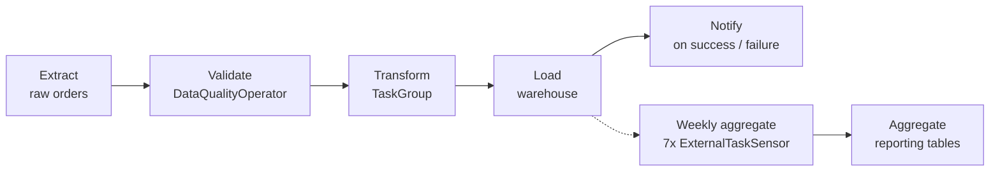

# Airflow Pipeline Orchestration

Portfolio implementation based on production work experience. All data is
synthetic, all code is original and clean-room, and no proprietary code, data,
schema names, or internal system details from any employer are included.

## The problem

A daily data pipeline is really a chain of jobs with dependencies: extract,
validate, transform, load, then aggregate. Run them by hand or by cron and
there is no retry when one step fails, no alert when the whole run is late,
and no single place to see what ran, what failed, and what is still waiting.
A failed extract at 2am becomes a missing dashboard at 9am.

## What it does

Two Airflow DAGs orchestrate the whole flow, with retries, SLAs, alerting,
and a weekly rollup that waits for the daily runs to finish.

- `daily_orders_pipeline` — daily ETL: extract raw orders, validate them,
  transform into a clean model, load to the warehouse, then notify.
- `weekly_aggregate_pipeline` — weekly rollup: one `ExternalTaskSensor`
  per day of the week (7 by default, set by `weekly_wait_days` in config),
  then aggregates the week into reporting tables.

A custom `DataQualityOperator` runs the same rule checks the local runner
uses (not-null, uniqueness, range) against the staged CSV and fails the
task, triggering Airflow's retry, when a rule breaks. The local runner in
`src/run_local.py` executes the same stage functions in plain Python, so
the pipeline logic can be exercised without a running Airflow instance.

## Architecture — Before / After

### Before

Jobs ran on cron, one script per step, with no dependency tracking. A failed
step left the next step running on yesterday's file, or not running at all,
and nobody knew until a dashboard looked wrong. Retries meant re-running
scripts by hand.

### After

One DAG owns the whole chain. Each step runs only after its upstream
succeeds, a failed step retries automatically, an SLA miss pages on-call,
and the weekly rollup waits for the daily runs instead of guessing.



<details>
<summary><b>Daily pipeline flow — click to expand</b></summary>

<br>

1. **Extract:** read the day's raw order records, check them against the
   schema (`src/schema.py`), and stage a copy.
2. **Validate:** the custom `DataQualityOperator` runs not-null, uniqueness,
   and range checks; a failure fails the task and Airflow retries it.
   The transform step then quarantines the bad rows instead of loading them.
3. **Transform:** a TaskGroup cleans (drops bad rows, writes the quarantine
   file), enriches (normalises region/channel, derives `amount_usd`), and
   models the records into the warehouse shape. Each step writes its own
   stage file, so a failed task can be re-run without re-running the chain.
4. **Load:** write the clean records to the warehouse file, overwriting the
   day's partition, so a re-run for the same date is idempotent.
5. **Notify:** on success, log the row counts; on failure, the shared
   `on_failure` callback logs the DAG, task, run, and try for on-call.
6. **Weekly rollup:** the weekly DAG senses the daily DAG's `load` task for
   each day of the week, then aggregates into reporting tables.

</details>

| Earlier issues | Risk | Impact after |
|---|---|---|
| Cron scripts with no dependency tracking | A step ran on stale data, or not at all, after an upstream failure | Each step runs only after its upstream succeeds |
| No retries, manual re-runs | A transient failure needed someone awake to fix it | Failed tasks retry automatically with backoff |
| No SLA or alerting | A late run was discovered by a user, hours later | SLA misses alert on-call; failure callbacks notify immediately |
| Weekly job guessed at daily completion | Rollups ran on partial weeks | One `ExternalTaskSensor` per day waits for the daily DAG to succeed |
| Validation lived outside the pipeline | Bad data landed before anyone checked it | Validation is a task in the DAG, blocking the load on failure |
| Hardcoded counts and `print()` in tasks | Stubs looked green while doing nothing | Tasks call the real stage functions and log metrics |

## Design notes

- **Config is the policy.** Schedule, retries, SLA, owners, data-quality
  rules, schema columns, and the weekly wait-day count live in
  `config/pipelines.yaml` and are loaded as typed dataclasses by
  `src/config.py`. The DAGs read it through `dags/common.py`; nothing in
  the DAG code hardcodes those values.
- **One rule engine.** `src/validation.py` is the only implementation of
  the not-null / unique / range checks. The operator and the local runner
  both call it, so the checks cannot drift. Validation never mutates its
  input and never crashes on bad data: every broken rule is recorded with
  the row and the reason, and only the later occurrence of a duplicate is
  rejected (the first occurrence loads).
- **Quarantine, not silent drops.** Bad rows are written to
  `data/quarantine.csv` with their original values, never to the warehouse.
  When a run has no bad rows, a stale quarantine file is removed so it
  cannot be mistaken for that run's rejects.
- **Idempotency.** The load overwrites the day's partition, writes are
  atomic (temp file + rename), and validation is a pure function of its
  input, so re-running a date produces identical output. Verified by test.
- **Errors mean something.** `src/exceptions.py` defines one exception per
  failure mode (`ConfigError`, `SchemaError`, `DataQualityError`,
  `TransformError`, `StorageError`) instead of bare `ValueError`s.
- **No credentials, no hardcoded paths.** Paths resolve from the project
  root (or the `PIPELINE_CONFIG` / `--data-dir` overrides); there are no
  passwords, keys, or absolute home paths anywhere in the repo.
- **Synthetic data only.** The generator (`src/generate_data.py`) invents
  every value with a fixed seed (default 42, 118 good rows + 3 deliberately
  bad ones for 2026-11-22). No real customer, order, or amount data is used,
  and no numbers in this README are measured production figures.

## Setup and run

```bash
# Local simulation of the daily pipeline (no Airflow needed).
# Only PyYAML is required; use a venv so pytest is available.
python -m venv .venv
.venv/bin/pip install -r requirements-dev.txt

# Generate the synthetic input, then run the daily pipeline
python -m src.generate_data
python -m src.run_local

# Run the test suite (77 tests, no Airflow needed)
python -m pytest tests/ -q
```

With Airflow installed, deploy the whole repo (the DAGs import `src/`), point
Airflow at the `dags/` folder, and enable `daily_orders_pipeline` and
`weekly_aggregate_pipeline`:

```bash
pip install -r requirements.txt
airflow dags list
```

Example output from the local run (actual log lines, paths shortened):

```
INFO wrote 121 rows to data/orders.csv
INFO validation: 121 rows in, 118 clean, 3 rejected {'not_null:customer_id': 1, 'unique:order_id': 1, 'range:amount': 1}
WARNING validate: 3 rule failures across 3 records: {'not_null:customer_id': 1, 'unique:order_id': 1, 'range:amount': 1}
INFO transform: 118 clean records modeled, 3 quarantined
INFO load: 118 records written to data/warehouse_orders.csv
INFO daily run 2026-11-22: 121 in, 118 clean, 3 rejected {...}, 118 loaded
INFO notify: daily_orders_pipeline succeeded, 118 rows loaded (3 quarantined)
```

## Files

- `dags/daily_orders_pipeline.py` — daily ETL DAG (extract, validate, transform TaskGroup, load, notify)
- `dags/weekly_aggregate_pipeline.py` — weekly rollup DAG, one ExternalTaskSensor per day
- `dags/common.py` — config-driven default args, SLA, retry policy, shared failure callback
- `plugins/operators/data_quality_operator.py` — custom operator running the shared rule engine over a staged CSV
- `plugins/sensors/partition_sensor.py` — sensor that waits for a dated partition file
- `config/pipelines.yaml` — schedule, retries, SLA, owners, rules, schema, weekly wait days
- `src/config.py` — typed config loading and validation
- `src/exceptions.py` — one exception type per failure mode
- `src/schema.py` — expected columns, types, allowed regions/channels
- `src/validation.py` — the data-quality rule engine + quarantine split
- `src/transform.py` — clean / enrich / model steps (pure functions)
- `src/storage.py` — CSV read and atomic write
- `src/pipeline.py` — daily pipeline stages shared by the DAG and the local runner
- `src/generate_data.py` — synthetic data generator (seeded, deterministic)
- `src/run_local.py` — plain-Python runner for the daily pipeline
- `tests/` — 77 tests: rule engine, schema, transforms, storage, generator, end-to-end pipeline, operator/sensor, config, and DAG structure + stubbed-Airflow DAG import tests

## Deliberately simple

- **File-based stage handoff, not a warehouse.** The "warehouse" is a CSV
  file under `data/`. That keeps the repo runnable without infrastructure
  while showing the real habits (partition overwrite, atomic writes,
  quarantine). Swapping `src/storage.py` for a warehouse writer is the
  intended next step, not a hidden gap.
- **One synthetic source file.** The extract reads `data/orders.csv` for
  its run date instead of pulling a dated partition from a source system;
  the staging, validation, transform, and load steps are already
  date-partitioned. A real source connector belongs in `stage_extract`.
- **No live Airflow run in CI.** There is no `.github/workflows` file in
  this repo by design. The DAGs are verified by AST checks plus tests that
  import them against stubbed Airflow modules; a real scheduler run is
  still the step that would catch Airflow-version quirks.

Last verified locally: 2026-11-24 (77 tests passing, local run as above).
