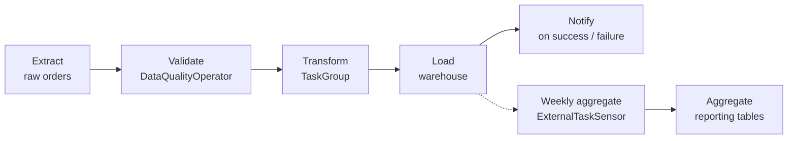

# Airflow Pipeline Orchestration

Portfolio implementation based on production work experience. All data is
synthetic, all code is original and clean-room, and no proprietary code, data,
schema names, or internal system details from any employer are included.

## The problem

A daily data pipeline is really a chain of jobs with dependencies: extract,
validate, transform, load, then aggregate. Run them by hand or by cron and
there is no retry when one step fails, no alert when the whole run is late,
and no single place to see what ran, what failed, and what is still waiting.
A failed extract at 2am becomes a missing dashboard at 9am.

## What it does

Two Airflow DAGs orchestrate the whole flow, with retries, SLAs, alerting,
and a weekly rollup that waits for the daily runs to finish.

- `daily_orders_pipeline` — daily ETL: extract raw orders, validate them,
  transform into a clean model, load to the warehouse, then notify.
- `weekly_aggregate_pipeline` — weekly rollup: waits for the daily DAG with
  an `ExternalTaskSensor`, then aggregates the week into reporting tables.

A custom `DataQualityOperator` runs the same rule checks the validation
framework uses (not-null, uniqueness, range) and fails the task, triggering
Airflow's retry, when a rule breaks. The local runner in `src/run_local.py`
executes the same steps in order in plain Python, so the pipeline logic can
be exercised without a running Airflow instance.

## Architecture — Before / After

### Before

Jobs ran on cron, one script per step, with no dependency tracking. A failed
step left the next step running on yesterday's file, or not running at all,
and nobody knew until a dashboard looked wrong. Retries meant re-running
scripts by hand.

### After

One DAG owns the whole chain. Each step runs only after its upstream
succeeds, a failed step retries automatically, an SLA miss pages on-call,
and the weekly rollup waits for the daily runs instead of guessing.



<details>
<summary><b>Daily pipeline flow — click to expand</b></summary>

<br>

1. **Extract:** pull the day's raw order records into a staging location.
2. **Validate:** the custom `DataQualityOperator` runs not-null, uniqueness,
   and range checks; a failure fails the task and Airflow retries it.
3. **Transform:** a TaskGroup cleans, enriches, and models the records into
   the warehouse shape.
4. **Load:** write the clean records to the warehouse table, replacing the
   day's partition.
5. **Notify:** on success, log the row counts; on failure, alert on-call.
6. **Weekly rollup:** the weekly DAG senses the daily DAG's success for each
   day of the week, then aggregates into reporting tables.

</details>

| Earlier issues | Risk | Impact after |
|---|---|---|
| Cron scripts with no dependency tracking | A step ran on stale data, or not at all, after an upstream failure | Each step runs only after its upstream succeeds |
| No retries, manual re-runs | A transient failure needed someone awake to fix it | Failed tasks retry automatically with backoff |
| No SLA or alerting | A late run was discovered by a user, hours later | SLA misses alert on-call; failure callbacks notify immediately |
| Weekly job guessed at daily completion | Rollups ran on partial weeks | `ExternalTaskSensor` waits for the daily DAG to succeed |
| Validation lived outside the pipeline | Bad data landed before anyone checked it | Validation is a task in the DAG, blocking the load on failure |

## Run

```bash
# Local simulation of the daily pipeline (no Airflow needed)
python -m src.generate_data
python -m src.run_local

# Validate the DAG definitions (static checks, no Airflow needed)
python -m pytest tests/ -q

# With Airflow installed, point it at the dags/ folder
# and enable daily_orders_pipeline and weekly_aggregate_pipeline
pip install -r requirements.txt
airflow dags list
```

Example output:

```
extract:   121 raw records staged
validate:  3 rule failures across 3 records
transform: 118 clean records modeled
quarantine: 3 records quarantined (never to warehouse)
load:      118 records written to warehouse/orders (partition 2026-11-22)
notify:    daily_orders_pipeline succeeded, 118 rows
```

## Files

- `dags/daily_orders_pipeline.py` — daily ETL DAG (extract, validate, transform, load, notify)
- `dags/weekly_aggregate_pipeline.py` — weekly rollup DAG with an ExternalTaskSensor
- `dags/common.py` — shared default args, SLA, and retry policy
- `plugins/operators/data_quality_operator.py` — custom operator running rule checks
- `plugins/sensors/partition_sensor.py` — sensor that waits for a dated partition file
- `config/pipelines.yaml` — schedule, retries, SLA, and owners per DAG
- `src/generate_data.py` — synthetic data generator
- `src/run_local.py` — plain-Python simulation of the daily pipeline steps
- `tests/test_dags.py` — static DAG validation (structure, retries, catchup, dependencies)
- `tests/test_config.py` — config validation
